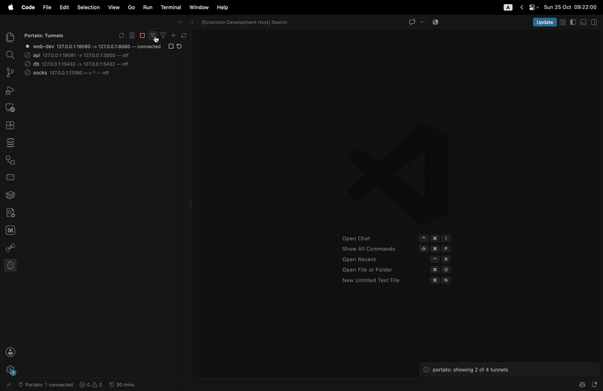

# Portato for VS Code

A VS Code extension -- a client for the [Portato](https://github.com/portuber/portato)
daemon: manage SSH port-forwarding tunnels from the sidebar.



The extension is only a client: the daemon, the config and all SSH logic
live in the `portato` binary. It discovers a running daemon on its own
(marker file or runtime socket) and keeps the tree in sync over SSE; when
no daemon is running, the view offers a Start button that launches one
(it never spawns a daemon on its own).

## Features

- **Tunnels tree** with live status for all five tunnel states (off,
  connecting, connected, reconnecting, error) -- updates arrive over SSE,
  no manual refresh needed.
- **Tunnel actions**: enable / disable / restart, plus add / edit / delete
  in a form that round-trips every config field (with a name-conflict
  check) and drag-and-drop reordering.
- **Tags**: group tunnels by tag, filter by text.
- **Prompts**: passphrase and password prompts pop up as notifications
  (empty secrets need an explicit confirmation); unknown host keys open a
  TOFU modal with the fingerprint.
- **Identities**: store / forget the passphrase of a tunnel's identity key.
- **Logs**: a single "Portato Logs" output channel, daemon-wide or filtered
  to one tunnel, with a minimum-level filter.
- **Daemon lifecycle**: start / stop the daemon from the view; if the daemon
  dies mid-session the view degrades to a "not running" state with a Start
  button and picks it back up automatically.

## Commands

Everything is reachable from the Portato view; the palette commands are a
convenience subset.

| Command | Palette | Where |
| --- | --- | --- |
| Portato: Refresh | yes | view title |
| Portato: Start Daemon / Stop Daemon | yes | view title |
| Portato: Show Logs | yes | view title |
| Portato: Set Log Level... | yes | view title |
| Portato: Filter Tunnels... | yes | view title |
| Portato: Clear Tunnel Filter | no | view title (while a filter is active) |
| Portato: Add Tunnel | yes | view title |
| Portato: Reload Config | yes | view title |
| Portato: Enable Tunnel / Disable Tunnel / Restart Tunnel | no | tunnel inline actions |
| Portato: Answer Prompt | no | tunnel inline action |
| Portato: Show Tunnel Logs | no | tunnel context menu |
| Portato: Store Identity Passphrase / Forget Identity Passphrase | no | tunnel context menu |
| Portato: Edit Tunnel / Delete Tunnel | no | tunnel context menu |

## Settings

| Setting | Default | Description |
| --- | --- | --- |
| `portato.binaryPath` | `portato` | Path to the `portato` binary used to start the daemon. Set it when VS Code cannot find `portato` on its PATH (common for GUI-launched VS Code on macOS). Machine scope: set it in user settings, not per workspace. |
| `portato.socketPath` | `portato` default discovery | Explicit daemon socket path. Overrides discovery; use it if your shell exports `PORTATO_SOCKET` that a GUI-launched VS Code cannot see, or to point at a non-default daemon. Machine scope: set it in user settings, not per workspace. |
| `portato.groupByTag` | `false` | Group tunnels by their first tag in the tree. |
| `portato.minLogLevel` | `info` | Minimum level shown in the `Portato Logs` view. The **Portato: Set Log Level...** command overrides it for the current session. |
| `portato.autoStartDaemon` | `false` | Start the daemon automatically when the Tunnels view opens and none is running. At most once per window, never after you stop the daemon yourself, and only when the `portato` binary resolves. Machine scope. |
| `portato.showNotifications` | `true` | Informational notifications only (copy confirmations, filter results). Warnings, errors and passphrase/host-key prompts are always shown. |

## Requirements

- VS Code 1.90 or newer (the bundled extension host runs Node 20, matching
  the extension's build target).
- The [portato](https://github.com/portuber/portato) CLI installed and on
  PATH (or pointed to by `portato.binaryPath`). When no daemon is running,
  start it from the Portato view; an externally started daemon is picked
  up too.

## Platform support

macOS and Linux only. The daemon's Windows build serves a named pipe
(`\\.\pipe\portato`, see `internal/daemon/paths_windows.go`) and this
extension does not implement that transport yet; on Windows it degrades to
"daemon not running". Full Windows support is a planned, separately tested
task.

## Development

```sh
npm install
npm run compile          # esbuild -> out/extension.js
npm run watch            # + F5 (Run Extension) in VS Code
npm run typecheck
npm test                 # unit tests (no VS Code, no daemon needed)
npm run test:integration # against a disposable real daemon (needs portato)
npm run package          # vsce package -> .vsix
```

CI runs typecheck, compile, unit tests and packaging on every push and PR
(.github/workflows/ci.yml); integration tests need a real daemon and stay
on dev machines.

## Releasing

Releases are cut with the Makefile targets and published automatically:

```sh
make release-patch  # v1.2.3 -> v1.2.4
make release-minor  # v1.2.3 -> v1.3.0
make release-major  # v1.2.3 -> v2.0.0
make release VERSION=v1.2.4  # explicit
```

A release requires a clean working tree and a `## [X.Y.Z]` section already in
[CHANGELOG.md](CHANGELOG.md), runs typecheck and unit tests locally, then asks
for confirmation, bumps `package.json` and `package-lock.json`, commits, tags
`vX.Y.Z` and pushes. The tag
triggers [.github/workflows/release.yml](.github/workflows/release.yml):
typecheck, compile, unit tests, `vsce package`, a tag/version guard, a GitHub
Release with the `.vsix` and checksums (release notes taken from the CHANGELOG
section), and a Marketplace publish via the `VSCE_PAT` repository secret.

## Versioning

Semantic Versioning 2.0.0, stable `vX.Y.Z` tags only -- no pre-release, RC
or beta tags (same policy as [portato](https://github.com/portuber/portato)).
While the major is `0`, a breaking change bumps the minor (`0.1.0` ->
`0.2.0`), never the patch, and is flagged **BREAKING** in the release notes.

The version number is a contract over the user-facing surfaces only: the
`portato.*` command IDs, their titles, and the `portato.*` settings keys
and defaults. Everything else -- tree layout, icons, the webview form,
wording -- is free to change in any release.

The daemon IPC the extension speaks is portato's contract, not this one:
a release notes when it needs a newer daemon (the daemon reports its
version since v1.11.0).

## License

[MIT](LICENSE)
